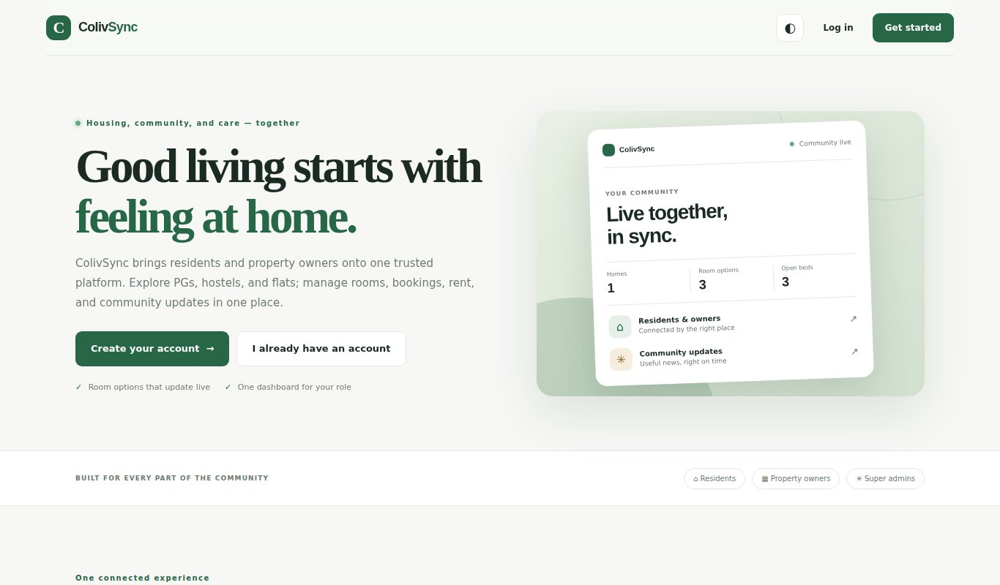
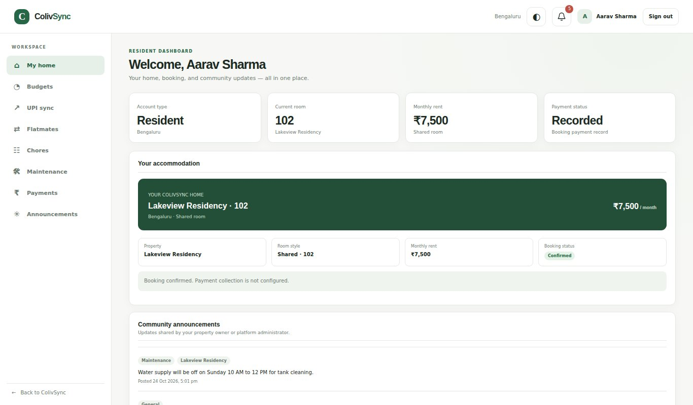
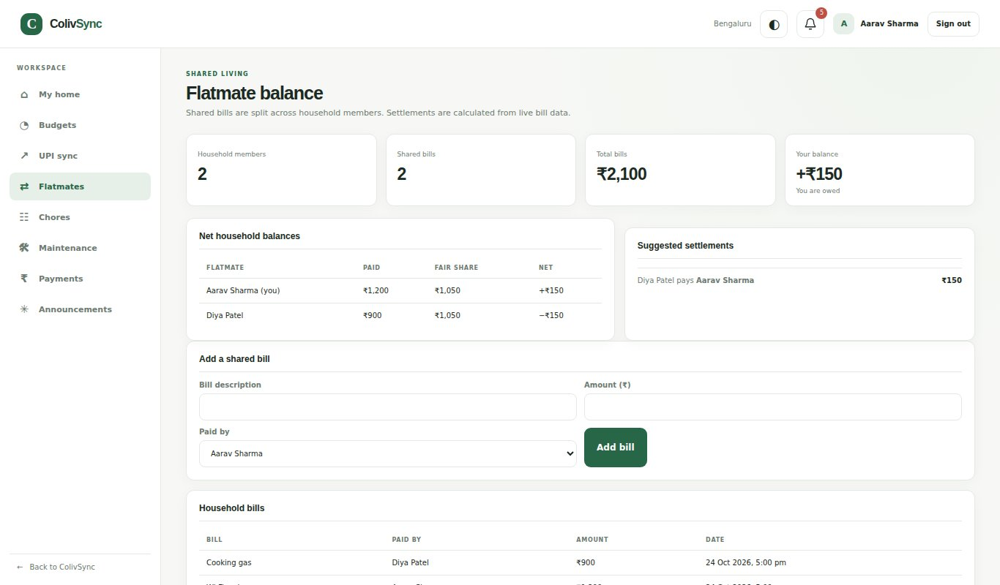
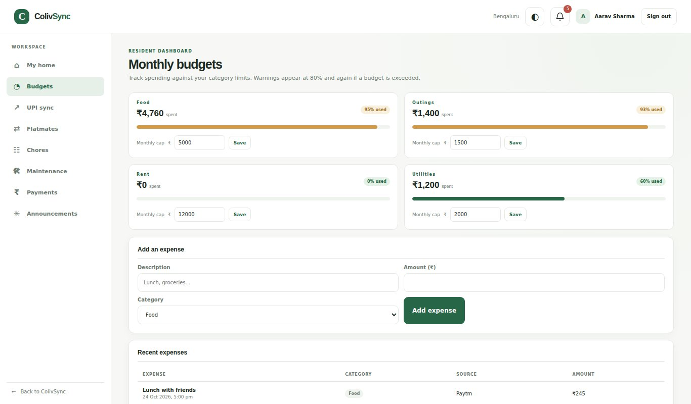
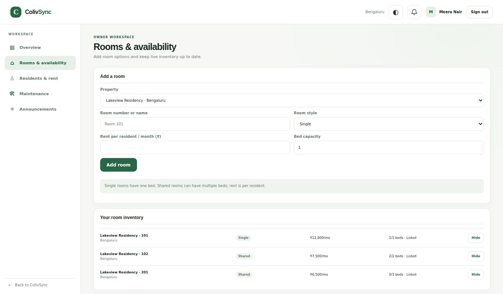
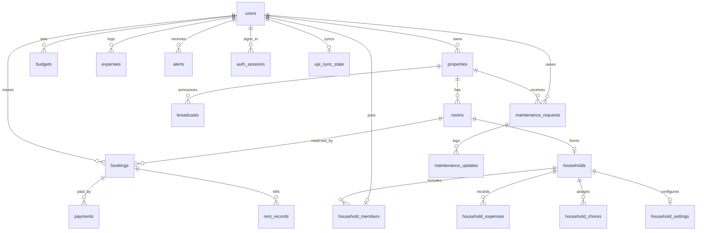

# 🏠 ColivSync — Smart Co-living Management Platform

> A role-based web platform where **residents**, **property owners** and a **super admin** manage PGs, hostels and flats — rooms, bookings, rent, budgets, shared expenses, chores, maintenance and announcements — in one place.

Built for the **Front-End Frameworks & Technologies** capstone (MCA, Semester I — Alliance University).

| | |
|---|---|
| **Frontend** | HTML5 · Tailwind CSS (CDN) · custom responsive CSS · modern vanilla JavaScript (Fetch API) |
| **Backend** | Node.js · Express 4 |
| **Database** | SQLite via `better-sqlite3` (WAL mode, foreign keys ON) |
| **Auth** | scrypt password hashing · random bearer tokens (stored as SHA-256 hashes) · 7-day server-side sessions |
| **Hosting** | Frontend → Netlify · Backend + database → Render |



---

## ✨ Features

### 👤 Resident
- Register, pick a **location → property type (PG / Hostel / Flat) → listed property → room**, then confirm a one-month **demo** booking payment (room is reserved for 15 minutes).
- **Budgets & expenses** per category (Food, Utilities, Rent, Outings) with automatic **80 % warning / 100 % breach alerts**.
- **Mock UPI sync** (labelled Google Pay / PhonePe / Paytm) that imports deterministic sample transactions without duplicates.
- **Flatmate balances** for shared rooms: who paid, equal share, and the simplest "who pays whom" transfers.
- **Chore wheel** with **exam/thesis crunch mode** — notifies the household and temporarily reassigns your chores.
- **Maintenance requests** with priority, optional photo, and a threaded update log.
- Rent/payment status and property announcements.

### 🏢 Property owner
- Register with a first property; add more properties and rooms (number, Single/Shared, capacity, monthly rent).
- Toggle room availability, view residents and rent status, handle maintenance requests, post announcements.

### 🛡️ Super admin
- Live platform totals, all properties / rooms / people / bookings, tenant ledger.
- Hide or show listings, verify residents, pause or reactivate accounts, update rent status, broadcast announcements by location.

| Resident dashboard | Shared flat balances |
|---|---|
|  |  |
| **Budgets & alerts** | **Owner — rooms** |
|  |  |

---

## 🧱 Architecture

```
Browser (HTML + Tailwind + vanilla JS)
        │  fetch('/api/...')  + Authorization: Bearer <token>
        ▼
Express server  ──  static files from /frontend  +  REST API under /api
        │
        ▼
better-sqlite3  ──►  colivsync.db  (SQLite file)
```

* **Locally** one Express process serves both the frontend and the API on the same origin.
* **In production** the frontend is hosted on Netlify and `netlify.toml` proxies every `/api/*` call to the Express backend on Render, so the browser still sees a single origin (no CORS setup needed).

> ⚠️ **Why not run everything on Netlify?** Netlify hosts static files and serverless functions; it cannot run a long-lived Express server or keep a writable SQLite file. That is why the backend lives on Render.

### Project structure

```
ColivSync/
├── backend/
│   ├── server.js          # Express app: auth, roles, all REST endpoints
│   └── database.js        # SQLite schema, migrations, indexes, admin seed
├── frontend/
│   ├── index.html         # landing page + login/register modals
│   ├── dashboard.html     # role-based dashboard shell
│   ├── css/site.css       # custom responsive styles (light/dark theme)
│   └── js/
│       ├── api.js         # fetch helper (adds bearer token)
│       ├── home.js        # landing page + registration flows
│       └── app.js         # resident / owner / admin dashboards
├── test/platform.test.js  # automated API tests
├── docs/screenshots/      # images used in this README
├── netlify.toml           # Netlify publish dir + /api proxy
├── render.yaml            # Render blueprint for the backend
├── .env.example           # environment variable reference
├── DEPLOYMENT_GUIDE.md    # GitHub → Render → Netlify, step by step
└── package.json
```

---

## 🚀 Run locally

**Requirements:** [Node.js 18+](https://nodejs.org) (20 LTS recommended) and Git.

```bash
git clone https://github.com/<your-username>/<your-repo>.git
cd <your-repo>
npm install
npm start
```

Open **http://localhost:5000**.

| Command | What it does |
|---|---|
| `npm start` | Start the server (serves frontend + API) |
| `npm run dev` | Start with auto-restart on file changes (`node --watch`) |
| `npm test` | Run the automated API tests |

The SQLite file `backend/colivsync.db` is **created automatically** on first start, with all tables, indexes and the admin account. Existing databases are migrated in place.

### Environment variables

| Variable | Default | Purpose |
|---|---|---|
| `PORT` | `5000` | HTTP port |
| `NODE_ENV` | — | Set to `production` on the host. Disables the built-in demo admin password |
| `COLIVSYNC_ADMIN_PASSWORD` | `Admin@123` (dev only) | Password for `admin@colivsync.com` (min 8 chars). **Required in production** |
| `COLIVSYNC_DB_PATH` | `backend/colivsync.db` | SQLite file location (use a persistent disk in production) |
| `COLIVSYNC_UPLOAD_DIR` | `backend/uploads/maintenance` | Where maintenance photos are stored |

### Demo account (development only)

| Role | Email | Password |
|---|---|---|
| Super admin | `admin@colivsync.com` | `Admin@123` |

The app starts with **no** sample residents, owners or rooms. Create an **owner** account first and add a property and rooms; then register a **resident** to book one.

---

## ☁️ Deploy (GitHub → Render → Netlify)

Full walk-through with every click: **[DEPLOYMENT_GUIDE.md](DEPLOYMENT_GUIDE.md)**. Summary:

1. Push this repo to GitHub.
2. **Render** → New Web Service → build `npm install`, start `npm start`, env `NODE_ENV=production` + `COLIVSYNC_ADMIN_PASSWORD`.
3. Put the Render URL into `netlify.toml` (the `/api/*` redirect), commit and push.
4. **Netlify** → Import from Git → publish directory `frontend`, no build command.

> **Database persistence:** Render's *free* plan has an ephemeral disk, so SQLite data is wiped on each redeploy/restart/spin-down — fine for a demo, not for real data. Attach a persistent disk on a paid plan (see `render.yaml`) or move to a hosted database to keep data.

---

## 🔌 API overview

All responses are JSON: `{ "success": true, ... }` or `{ "success": false, "message": "..." }`. Protected routes need `Authorization: Bearer <token>` (returned by login/registration).

| Group | Endpoints |
|---|---|
| **Public** | `GET /api/health` · `GET /api/public/overview` · `GET /api/locations` · `GET /api/properties` · `GET /api/properties/:id/rooms` |
| **Accounts** | `POST /api/register/tenant` · `POST /api/register/owner` · `POST /api/login` · `GET /api/me` · `POST /api/logout` |
| **Resident** | `GET /api/me/dashboard` · `GET/PUT /api/budgets` · `GET/POST /api/expenses` · `POST /api/upi/sync` · `GET /api/alerts` · `POST /api/alerts/read` · `GET /api/shared` · `POST /api/shared-expenses` · `GET /api/chores` · `POST /api/crunch` · `POST /api/payments/:id/confirm` · `POST /api/payments/:id/cancel` |
| **Maintenance** | `GET/POST /api/maintenance-requests` · `POST /api/maintenance-requests/:id/updates` · `PATCH /api/maintenance-requests/:id` (owner) · `GET /api/maintenance-requests/:id/photo` |
| **Owner** | `GET /api/owner/overview` · `GET /api/owner/rooms` · `GET /api/owner/rents` · `PATCH /api/owner/rents/:id` · `POST /api/owner/properties` · `POST /api/owner/properties/:id/rooms` · `PATCH /api/owner/rooms/:id` · `GET/POST /api/owner/announcements` · `DELETE /api/owner/announcements/:id` |
| **Admin** | `GET /api/admin/overview` · `/properties` · `/rooms` · `/users` · `/tenants` · `/bookings` · `PATCH /api/admin/users/:id/status` · `PATCH /api/admin/users/:id/verification` · `PATCH /api/admin/rents/:id` · `PATCH /api/admin/properties/:id` · `GET/POST/DELETE /api/admin/announcements` |

---

## 🗄️ Database design

SQLite, created and migrated by `backend/database.js`. Main tables:



| Table | Purpose |
|---|---|
| `users` | Residents (`student`), owners and admins; scrypt `password_hash`, `is_verified`, `is_active` |
| `properties`, `rooms` | Listings; rooms have Single/Shared type, capacity, rent, availability |
| `bookings`, `payments`, `rent_records` | Room reservation (15-min hold), simulated payment, monthly rent status |
| `budgets`, `budget_categories`, `expenses`, `alerts`, `upi_sync_state` | Personal finance: caps, spend, 80 %/100 % alerts, mock UPI import |
| `households`, `household_members`, `household_expenses`, `household_chores`, `household_settings` | Shared-room living: balances, chores, crunch mode |
| `maintenance_requests`, `maintenance_updates` | Issues raised by residents and owner responses |
| `broadcasts` | Announcements (by property or location, optional expiry) |
| `auth_sessions` | Hashed bearer tokens with expiry |

Older prototype tables (`flatmates`, `shared_expenses`, `chores`, `settings`, `tenants`) still exist in the schema for backward compatibility but are no longer used by the API.

---

## 🔐 Security notes

- Passwords: Node `crypto.scrypt` with a per-user random salt; timing-safe comparison.
- Sessions: 256-bit random tokens; only their SHA-256 hash is stored; tokens expire after 7 days; pausing an account invalidates it.
- All SQL uses parameterised prepared statements; role checks (`requireRole`) guard every protected route.
- The frontend escapes user text before inserting it into the DOM.
- **Payments are simulated.** No real UPI, bank or card is connected, and no real money moves.

Before real-world use add: HTTPS-only cookie sessions, login rate-limiting, email verification, audit logs, automated backups and a real payment gateway with verified webhooks.

---

## 🧭 Roadmap

Real payment gateway · email/SMS notifications · move to PostgreSQL for hosted persistence · image storage in cloud object storage · PWA/offline mode · multilingual UI · analytics for owners and admins.

---

## 👥 Team

| Name | Roll / ID |
|---|---|
| Kumhar Niteshkumar Gamnaram | PROV/ASAC/MCA/7/26/005 |
| Amrit Anand | PROV/ASAC/MCA/7/26/033 |
| Sachin Kumar | PROV/ASAC/MCA/7/26/010 |
| Aastha | PROV/ASAC/MCA/7/26/026 |

Guide: **Raghav K** · HOD: **Dr J Lenin** — Department of Computer Application, Alliance University, Bengaluru.

## 📄 License

ISC — for academic use.
